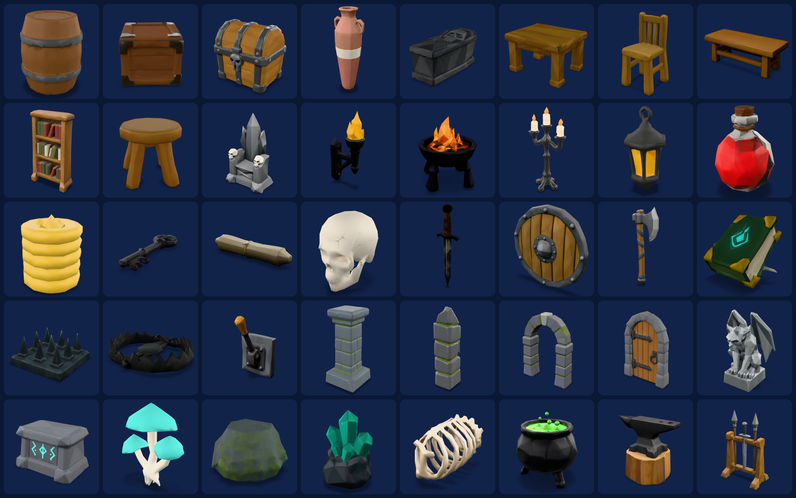
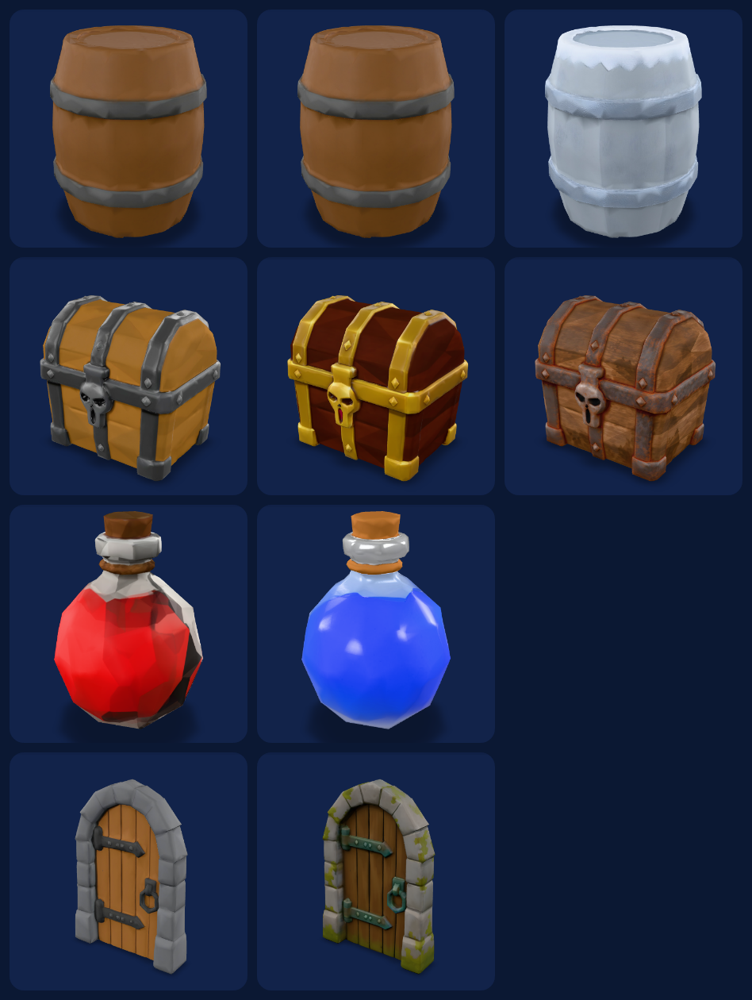

# Game Art Department

[Agent Skills](https://agentskills.io) that give your coding agent a full 3D art department. Describe your game and get a pack of matching, engine-ready 3D models, made with the [Sloyd API](https://www.sloyd.ai/api).



```sh
npx skills add Sloydai/game-art-skills --all
```

Works with Claude Code, Codex, Cursor, opencode, Kiro, and GitHub Copilot. You need your own Sloyd API key. [Step-by-step install](#install) takes about 5 minutes.

Made by [Sloyd](https://sloyd.ai). If it saves you a week of modelling, give it a star.

AI is great at making one cool 3D model, and bad at making 40 that look like they belong in the same game: a realistic barrel next to a cartoon chest, five different wood colors, a pedestal nobody asked for under the mushrooms.

These skills work like a small art team. An art director locks the style and tests it on 3 props before anything else is made. Then the team plans the pack, builds it, reviews every model, remakes the weak ones, and exports the result for your engine.

## What it does

1. **Locks the style.** The art director writes `style-bible.md` (palette, poly budget, proportions, one Sloyd style) and tests it on 3 props.
2. **Plans the pack.** It picks a mix of sizes and asset types that a real level needs, then shows you the cost before spending anything.
3. **Builds it.** Concept image first, then 3D, 5 models at a time. It resumes after interruptions and never pays twice.
4. **Reviews the set.** It renders every model, compares them side by side, and remakes the outliers.
5. **Adds variants and parts.** Gold, rusty, frozen or team-color versions from one mesh, and destructible or modular pieces.
6. **Exports for your engine.** Unity, Godot, Unreal or Roblox, at real-world scale, sitting on the floor, with per-engine names and import notes.

| Skill | Role |
|---|---|
| `game-art-director` | Runs the whole pipeline from one request. Start here. |
| `art-director` | Writes and tests the style bible |
| `concept-artist` | Concept images that turn into clean 3D |
| `modeler` | Text, image or multi-view to 3D |
| `look-dev` | Material, team-color and rarity variants |
| `asset-pack-builder` | Batched, resumable pack runs |
| `kitbasher` | Destructible and modular parts |
| `engine-export` | Scale, pivots, naming and import guides per engine |
| `sloyd-api` | Shared setup: API key, credits, job polling, errors |

## Real example

We asked for 40 props for a low-poly dungeon crawler. [See the pack.](examples/low-poly-dungeon/)

- **Result:** 40 props, 5 variants and a destructible barrel in 29 minutes, for 1,495 credits (about $20).
- **The first style test failed.** Every prop got every palette color, and the mushrooms grew a stone pedestal. The art director fixed the rules and retested before making the other 37.
- **Review caught 4 weak models**, which it remade: a blob-shaped boulder, an anvil with no stump, a plain chair and a soft coin stack.



## Install

Takes about 5 minutes. Do the steps in order.

### Before you start

You need these four things. Check each one in a terminal.

| You need | Check it with | If it's missing |
|---|---|---|
| A coding agent, for example [Claude Code](https://docs.claude.com/en/docs/claude-code) | `claude --version` | Install it from the link |
| Node.js 18 or newer | `node --version` | Download the LTS version from [nodejs.org](https://nodejs.org) |
| Python 3.9 or newer | Mac/Linux: `python3 --version`<br>Windows: `python --version` | Download from [python.org](https://www.python.org/downloads/). On Windows, tick **Add python.exe to PATH** in the installer |
| A Sloyd account | | Sign up free at [sloyd.ai](https://www.sloyd.ai) |

### Step 1. Open a terminal in your game project folder

Every command below runs in this folder, for example:

```sh
cd ~/projects/my-game
```

On Windows: `cd C:\Users\you\projects\my-game`

### Step 2. Install the skills

```sh
npx skills add Sloydai/game-art-skills --all
```

If it asks `Ok to proceed?`, type `y` and press Enter.

✅ You should see **Done!** at the end, and a new `.agents/skills` folder in your project.

### Step 3. Get your Sloyd API key

1. Go to [api-dashboard.sloyd.ai](https://api-dashboard.sloyd.ai) and sign in.
2. Open **API Keys** and click **Generate Key**.
3. Keep that page open. You'll copy the **Client ID** and the **Client Secret** in the next step. The secret is only shown once.
4. Open **Usage & Billing** and buy credits. The minimum is $12 for 900 credits, enough for a pack of about 25 props.

### Step 4. Save your key

Mac/Linux:

```sh
python3 .agents/skills/sloyd-api/scripts/sloyd.py setup
```

Windows:

```powershell
python .agents\skills\sloyd-api\scripts\sloyd.py setup
```

It asks two questions:

1. **Client ID:** paste it and press Enter.
2. **Client Secret:** paste it and press Enter. Nothing appears on screen while you paste. That's normal.

✅ You should see **Done. Your key works** and your credit balance.

The key is saved in a `.env` file in your project, and `.env` is added to `.gitignore` so it never gets committed. Never paste the secret into the chat with your agent.

### Step 5. Start your agent in the same folder

```sh
claude
```

If your agent was already open, close it and start it again. Skills only load when the agent starts.

### Step 6. Ask for your pack

Type this into your agent, changing the game, count and engine to yours:

> Use game-art-director to make 20 props for my low-poly dungeon game in Godot.

The agent shows you a 3-prop style test and the cost, and **waits for your OK before it spends any credits.** Then it builds the pack. That takes about 30 minutes for 40 props.

## If something goes wrong

| What you see | What to do |
|---|---|
| `npx: command not found` or `node: command not found` | Install Node.js (see [Before you start](#before-you-start)), then close and reopen the terminal |
| Windows: `npx.ps1 cannot be loaded because running scripts is disabled` | Use `npx.cmd skills add Sloydai/game-art-skills --all` instead |
| `python3: command not found` (Mac/Linux) | Install Python from [python.org](https://www.python.org/downloads/), then reopen the terminal |
| Windows: `python` opens the Microsoft Store | Install Python from [python.org](https://www.python.org/downloads/) and tick **Add python.exe to PATH** |
| `can't open file ... sloyd.py` | You're in the wrong folder. `cd` into your game project (Step 1), the one with `.agents` inside |
| `Sloyd rejected this key` | Copy the ID and secret again from the API Keys page and rerun Step 4. If you lost the secret, generate a new key |
| `You have 0 credits` or `402 insufficient credits` | Buy credits under **Usage & Billing** on [api-dashboard.sloyd.ai](https://api-dashboard.sloyd.ai) |
| The agent doesn't know `game-art-director` | Restart the agent from your project folder (Step 5) |

<details>
<summary><b>Other ways to install</b></summary>

**As a Claude Code plugin.** This also connects the Sloyd MCP server. In Claude Code:

```
/plugin marketplace add Sloydai/game-art-skills
/plugin install game-art@sloyd-game-art
```

The plugin reads your key from environment variables, so set them in the terminal before you start `claude`:

```sh
export SLOYD_CLIENT_ID="sok_live_..."
export SLOYD_CLIENT_SECRET="..."
```

On Windows PowerShell: `$env:SLOYD_CLIENT_ID="sok_live_..."` and `$env:SLOYD_CLIENT_SECRET="..."`. These only last until you close the terminal.

**By copying the folders.** Copy all 9 folders in [`skills/`](skills/) into your agent's skills folder, and keep them together because they call each other's scripts.

| Agent | Project folder | User folder |
| --- | --- | --- |
| Claude Code | `.claude/skills/` | `~/.claude/skills/` |
| Codex | `.agents/skills/` | `~/.agents/skills/` |
| opencode | `.opencode/skills/` | `~/.config/opencode/skills/` |
| Kiro | `.kiro/skills/` | `~/.kiro/skills/` |
| GitHub Copilot | `.github/skills/` | |

Then save your key from the same folder: `python3 <skills folder>/sloyd-api/scripts/sloyd.py setup`.

**Connect the Sloyd MCP server (optional).** The skills work without it. Configs for Claude Code, Cursor, VS Code and other clients are in [`skills/sloyd-api/references/clients.md`](skills/sloyd-api/references/clients.md).

</details>

## What you get

```
art/low-poly-dungeon/
├── style-bible.md        the locked look
├── plan.json             the asset list
├── manifest.json         every asset, job and file
├── concepts/  models/  variants/  parts/
├── export/godot/         engine-ready files + IMPORT.md
└── gallery.html          orbit every model in the browser
```

Other things to ask:

- `Lock a style bible for a cozy farming sim on mobile, then show me three test props.`
- `Turn this sketch into a game-ready model for Unity.` (attach an image)
- `Give the treasure chest gold, rusty and frozen variants.`
- `Make the barrel destructible: split it into 6 pieces.`
- `Export the whole pack for Roblox and warn me about anything over the triangle limit.`

## Cost

Sloyd API credits, at 75 credits per $1. The agent always shows the estimate and your balance before spending.

| Step | Credits |
|---|---|
| Concept image | 10 |
| Image to 3D | 20 |
| Text to 3D | 25 |
| Variant (retexture) | 15 |
| Split into parts | 40 |

A 40-prop pack is about 1,300 to 1,500 credits ($17 to $20), including style tests and rerolls. Current prices: [sloyd.ai/api/pricing](https://www.sloyd.ai/api/pricing).

## Privacy

Prompts and images you send are processed by Sloyd. See the [Sloyd privacy policy](https://www.sloyd.ai/privacy-policy).

## License

[MIT](LICENSE)
