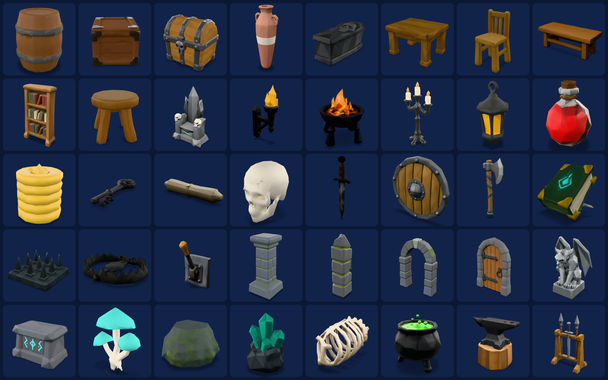
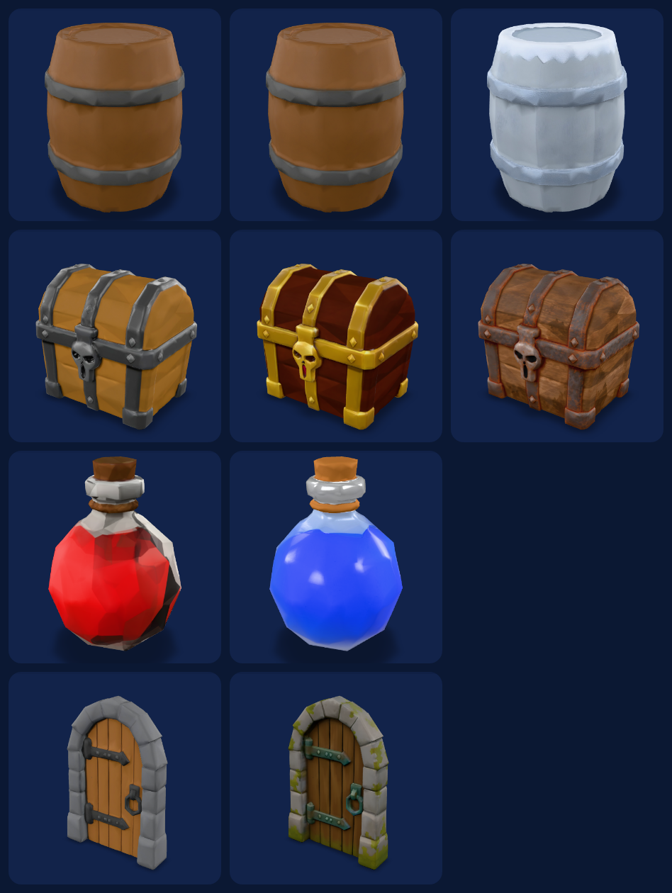
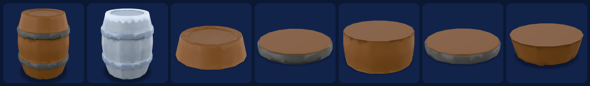

# Low-Poly Dungeon Props (40)

This is a real pack, made end to end by the Game Art Department skills with the Sloyd API on
2026-11-04. Every model below is an actual GLB from that run. `manifest.json` lists every jobId,
URL, triangle count and rerolled or rejected attempt.



## Numbers

| | |
|---|---|
| Props | 40 (planned as 31 concept route and 9 text route; after rerolls, 34 concept and 6 text) |
| Variants | 5 retextures: gold chest, rusty chest, mossy door, mana potion, frozen barrel |
| Destructible | barrel split into 5 parts (`partition`) |
| Style | `Polygonal`, triangles, 1k textures, budgets 1,200 / 3,000 / 6,000 / 10,000 triangles |
| Failed jobs | 0 |
| Production time | 29 min at 5 jobs in flight (6 min pilot + 23 min batch) |
| Credits | **1,495** (~$19.93), measured on the key: balance 2,000 → 505 |

Credit breakdown:

| Step | Credits |
|---|---|
| Style tests, 2 rounds x 3 images | 60 |
| The pack as planned: 40 props, 5 variants, 1 split | 1,270 |
| Rerolls (4 assets, rerun via the concept route) | 120 |
| Anvil texture fix | 15 |
| Frozen sword retry (rejected) | 15 |
| Frozen barrel (replacement variant) | 15 |

## What the art director caught

- **Style test 1 failed on all three images**, so the pack did not start. Listing the whole
  palette in the prompt suffix put every color on every prop. "Light edge wear" made ivory chips
  on the corners. The mushrooms grew a stone pedestal. The bible was fixed (colors per subject
  line, no wear, "no base") and test 2 passed. See `style-bible.md` for both rounds.
- **QA on the rendered contact sheet** flagged 4 outliers, which were rerolled:
  - boulder (flat green blob)
  - anvil (no stump)
  - chair (plain)
  - coin stack (soft column)

  Three of the four were text-route assets, which is why the modeler skill now defaults to the
  concept route.
- The new anvil had a stray blue stripe on the stump. One retexture fixed it.
- The **frozen sword** came back dark green twice. Frost does not read on a thin blade, so the
  frozen variant moved to the barrel.





## Files

```
style-bible.md        the locked look (approved after style test 2)
style-test/           the 3 approved test images
plan.json             the 40-asset plan (subjects, sizes, heights, routes, variants, split)
manifest.json         every job: jobId, URL, triangles, export names, rerolls, spend
concepts/             the 34 concept images that went into image-to-3D
gallery.html          orbit every model in the browser (loads the public Sloyd URLs)
images/               rendered contact sheets
export/<engine>/      IMPORT.md per engine with every file, triangle count, size and pivot
export/kit/           barrel part offsets (assembled and library pivots)
```

GLBs are not committed (about 100 MB per engine). To get them:

- **Single models:** every model, variant and split has a public URL in `manifest.json`
  (`jobs.<stage>.url`), for example the
  [treasure chest](https://storage.googleapis.com/ai-services-quality/jobs/xzfo7yax.glb).
- **The whole pack, engine-ready: rebuild it locally for free from this manifest.** Every job is finished, so nothing is
  charged, but your own Sloyd key is still needed for the balance check:

  ```bash
  python3 skills/asset-pack-builder/scripts/run_pack.py examples/low-poly-dungeon/plan.json --yes
  python3 skills/engine-export/scripts/glb_tool.py export examples/low-poly-dungeon/manifest.json --engine godot --godot-collision convcol
  ```

Every exported GLB passes the Khronos glTF validator with 0 errors. The only warning comes from
Sloyd sources: no stored tangents, which engines generate on import.

## Preview

```bash
cd examples/low-poly-dungeon && python3 -m http.server 8000
# open http://localhost:8000/gallery.html
```
